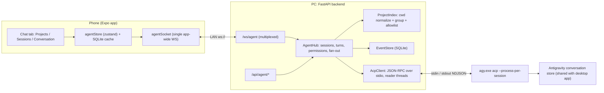
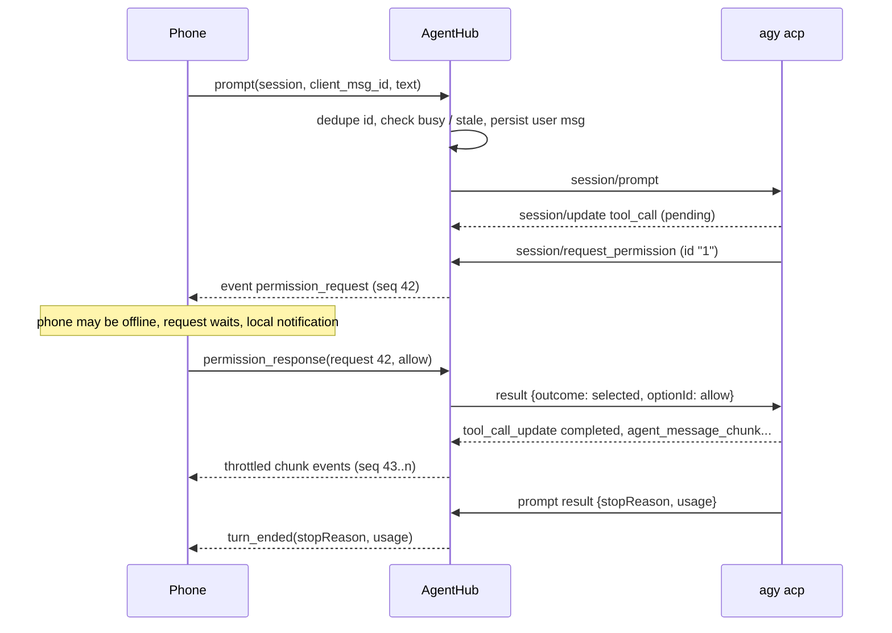

# Plan: Phone ↔ Antigravity Agent Chat (Core "CHAT" tab)

> Status: **PLAN, nothing implemented yet**. Every "verified" claim below was tested on this PC
> (agy 1.5.6, 2026-11-12). Claims marked **VERIFY** are assumptions that Phase 0 must confirm before we build on them.

---

## 1. Goal

From the phone, I want to:

1. **See my projects.** These are the workspaces Antigravity has conversations in (Core, FTune, Motio, …).
2. **Open a project** and see its conversations, newest first, with titles.
3. **Open a conversation** (including ones I started on the PC) and read its history.
4. **Send instructions.** The agent does the work on the PC and I watch the reply stream in live: text, tool calls, file edits.
5. **Approve or deny** the agent's commands and edits from the phone.
6. **Stop** a running turn, **switch model / mode**, or **start a new conversation** in any project.
7. Close the app, come back later, and **catch up** on whatever the agent did meanwhile.

The first target is Antigravity. The design uses a standard protocol (ACP), so Claude Code and Gemini CLI can plug in later without a rewrite.

---

## 2. What I verified on this PC (the facts this plan is built on)

| #   | Finding                                                                                                                                                                                                                                     | Evidence                                                  |
| --- | ------------------------------------------------------------------------------------------------------------------------------------------------------------------------------------------------------------------------------------------- | --------------------------------------------------------- |
| F1  | `agy.exe` is installed at `%USERPROFILE%\.gemini\bin\agy.exe` but **is not on PATH**.                                                                                                                                                       | `Get-Command agy` failed. The file exists, version 1.5.6. |
| F2  | `agy acp` starts an **Agent Client Protocol (JSON‑RPC over stdio) server**. This is the documented, official way for an app to drive the agent.                                                                                             | `agy help acp`                                            |
| F3  | ACP capabilities: `loadSession`, `session/list`, `resume`, `close`, `additionalDirectories`, **image prompts**, embedded context.                                                                                                           | `initialize` response                                     |
| F4  | `session/list` returns **every Antigravity conversation**, including ones made in the desktop app (this very planning conversation was in the list). 181 sessions, fields `sessionId, cwd, title, updatedAt`.                               | spike `acp_list.py`                                       |
| F5  | `session/list` **ignores the `cwd` filter** and has **no pagination**. We have to group and filter ourselves.                                                                                                                               | same spike                                                |
| F6  | `cwd` comes in **4 different formats** for the same folder: `/f%3A/Temporary%20Codebae/Core`, `/f:/…`, `/C:/…`, `F:\Temporary Codebae\Core`.                                                                                                | same spike                                                |
| F7  | `session/new` returns the available **models**, **modes** (`default`, `accept-edits`, `plan`) and config options (`model`, `thought_level`, `mode`).                                                                                        | spike                                                     |
| F8  | `session/set_config_option` switches model and thinking level live (e.g. `claude-sonnet-5-5`, `low`).                                                                                                                                       | spike                                                     |
| F9  | `session/load` **replays the full history** as `session/update` notifications.                                                                                                                                                              | spike                                                     |
| F10 | Full turn works: `tool_call` → `tool_call_update(pending)` → **`session/request_permission`** (options `allow`/`deny`) → answer → `tool_call_update(completed, rawOutput)` → `agent_message_chunk`s → `stopReason: end_turn` + token usage. | spike `acp_load_perm.py`                                  |
| F11 | **Quota exhaustion is not an error.** It arrives as normal agent text: `⚠ Individual quota reached… Resets in 53h…`, with `stopReason: end_turn`. The default model (Gemini 4 Argon) is exhausted right now.                                | spike                                                     |
| F12 | `available_commands_update` lists ~109 slash commands and skills (`/goal`, `/plan`, …), which gives us phone autocomplete.                                                                                                                  | spike                                                     |
| F13 | One trivial turn cost **~44.6k tokens** (most of it cached). That is the system prompt, skills and tools overhead, so every phone message is a full agent turn.                                                                             | `usage` in prompt result                                  |
| F14 | Antigravity also has an official **Remote Control** feature (`agy remote-control start`, phone browser dashboard, needs internet and the same Google account). It is not registered on this PC.                                             | `agy remote-control status`, docs                         |
| F15 | Protocol quirks: `tool_call` has non-standard `name`/`args` fields, capability keys are duplicated in snake_case and camelCase, and the permission request `id` is a **string** (`"1"`).                                                    | raw frames                                                |
| F16 | uvicorn 0.54 uses `ProactorEventLoop` on Windows **only when reload/workers are off**. With `SelectorEventLoop`, asyncio subprocesses throw `NotImplementedError`.                                                                          | `uvicorn/loops/asyncio.py`                                |

> [!NOTE]
> The spikes created one throwaway conversation titled **"Ping Reply Test"**, which now shows in the Antigravity list (cwd = this conversation's `scratch/acp_sandbox`). You can delete it.

### What exists today (and why it can't be extended as is)

`backend/api/websockets.py` `/ws/chat` + `services/cli_runner.py`:

- `cmd = f'agy {prompt}'` with `shell=True` is a **command injection hole**: anything typed on the phone runs as a shell command. The default `AGY_CLI_CMD` is `agy --help`, so it never actually chatted.
- It blocks the WS loop until the process exits. There is no streaming (all lines are collected, _then_ sent), there is a 30–45 s timeout, there are no sessions or projects, and nothing is persisted.
- The `powershell` target is **raw remote code execution from the phone**.
- `mobile/(tabs)/chat.tsx` keeps a single in-memory thread with a per-screen socket. Messages are lost on navigation, and every token triggers an O(n) `setMessages` map.

**Decision: replace the Antigravity path entirely with an ACP bridge.** The old `/ws/chat` stays only until the new mobile screen ships, and then it gets removed.

---

## 3. Decision 0: build our own, or use the official Remote Control?

|                                                        | Official `agy remote-control`                                | Our ACP bridge in Core (this plan)             |
| ------------------------------------------------------ | ------------------------------------------------------------ | ---------------------------------------------- |
| Effort                                                 | ~0 (run `agy remote-control start`, open dashboard on phone) | Several phases of work                         |
| Network                                                | Needs internet + Google sign-in on phone                     | Works on LAN; off-LAN via Tailscale (optional) |
| Integrated with Core app (files, actions, telemetry)   | No, separate web app                                         | Yes, one app                                   |
| Custom UX (approvals, git diff, notifications our way) | No                                                           | Yes                                            |
| Other agents (Claude Code / Gemini CLI via ACP)        | No                                                           | Yes, later                                     |

**Recommendation:** build the Core bridge, since that's the vision. You can still try the official Remote Control **today** as a stopgap. Rule: **never drive the same conversation from both at once** (see L1).

---

## 4. Architecture



### Prompt + approval sequence



---

## 5. Backend design

### 5.1 New files

```
backend/services/agent/
  agy_locator.py   # find agy.exe (config > PATH > %USERPROFILE%\.gemini\bin), read version
  acp_client.py    # JSON-RPC stdio client: thread readers, request futures, notification/request dispatch
  events.py        # ACP update -> phone event mapping, truncation, quota detection
  projects.py      # cwd normalizer, grouping, noise filter, allowlist, project_id hashing
  store.py         # SQLite event store (backend/data/agent.db, gitignored)
  hub.py           # AgentHub: loaded-session LRU, turn state machine, permission registry, queue, fan-out
backend/api/routes_agent.py   # REST
backend/api/ws_agent.py       # /ws/agent
backend/tests/fake_acp_agent.py  # scripted ACP agent for tests (no quota)
backend/tests/test_projects.py, test_acp_client.py, test_hub.py
```

### 5.2 AcpClient rules (each one fixes a real failure mode)

1. **Spawn with argv, never `shell=True`:** `[agy, "acp", "--process-per-session", "--log-file", logs/agy_acp.log]`. Use `cwd=%USERPROFILE%` and `creationflags=CREATE_NO_WINDOW`.
2. **Thread-based IO, not asyncio subprocess.** This works under any event loop (F16). Blocking reader threads push into the loop with `loop.call_soon_threadsafe`.
3. **Read stdout line by line with no 64 KB cap.** `asyncio.StreamReader` defaults to a 64 KB limit, and tool outputs plus the 109-command list are bigger than that.
4. **Always drain stderr** into the log file. A full stderr pipe would deadlock agy.
5. **Serialize stdin writes with a lock.** Concurrent writes would interleave JSON lines.
6. Use **UTF-8 explicitly** in both directions (`⚠`, emoji, non-ASCII paths).
7. **Echo the id back exactly as received** (string or int, F15) when answering agent→client requests.
8. Reply to **unknown agent→client methods** (`fs/*`, `terminal/*`, …) with JSON-RPC error `-32601` so the agent never hangs. Declare `fs: false, terminal: false` in `initialize`.
9. **Tolerant parsing**: Pydantic models with `extra="allow"`, accept both camel- and snake-case keys.
10. **Supervisor**: on process exit, restart with backoff (1, 2, 5, 10, 30 s). Mark in-flight turns `interrupted`, cancel pending permissions, and re-load sessions lazily.
11. **Shutdown**: kill the whole process tree (`psutil` children), because `--process-per-session` spawns workers.
12. **Log the version** from `agentInfo.version` at handshake. agy auto-updates (`agy.exe.old.*`), so the protocol can drift. Log a warning if the version changed since the last run.

### 5.3 AgentHub behavior

- **Turn state machine per session:** `idle → running → (awaiting_permission ↔ running) → idle`.
- **One turn at a time per session.** A prompt sent while a turn is running goes into a **queue of up to 3**, shown on the phone as "queued". It is not rejected silently.
- **Global cap** on concurrent running turns (default 2), to protect quota and CPU.
- **Dedupe:** every prompt carries a `client_msg_id` (UUID). A repeat within 10 min is ignored, which makes reconnect-resends safe.
- **Staleness check before each phone prompt (L1):** refresh `session/list`. If `updatedAt` is newer than our last known value, the desktop changed it, so call `session/close` + `session/load` before prompting. If it was updated in the **last 2 min**, send the phone a "this conversation is active on the PC" warning and require a confirm tap.
- **Loaded-session LRU** (default 6). Least recently used sessions get `session/close`, which keeps agy memory bounded.
- **Permission registry:** pending requests are stored in the DB. They survive phone disconnects, but not an agy restart (they get marked cancelled). The first phone to answer wins, and the others get `permission_resolved`. Optional `permission_timeout_s` (default **0 = wait forever**; never auto-allow).
- **Quota detection (F11):** if a turn's agent text starts with `⚠` or contains `quota reached`, emit a `warning` event with kind `quota`. The phone then shows a banner with a "switch model" button.
- **Default model per new session** from config (`agent_default_model`), because the agy default is currently quota-exhausted.
- **Keep the PC awake while a turn runs:** `SetThreadExecutionState(ES_CONTINUOUS|ES_SYSTEM_REQUIRED)`, released when idle.

### 5.4 Event model (phone-facing, versioned `v: 1`)

Each session has a monotonically increasing `seq`. Event kinds:
`user_message`, `agent_chunk`, `thought_chunk`, `tool_call`, `tool_update`, `plan`, `permission_request`, `permission_resolved`, `turn_started`, `turn_ended {stopReason, usage}`, `title`, `config`, `commands`, `warning`, `error`, `queued`.

- **Storage:** while a turn runs, chunks live in an in-memory buffer (so a reconnecting phone can catch up mid-turn). On `turn_ended`, chunks are **consolidated** into one message row. The DB stores messages and tool cards, not individual tokens.
- **Tool output truncation:** the phone gets a 4 KB preview plus `has_more`. The full output can be fetched through REST.
- **History for PC-made conversations:** on first open, run `session/load`, convert the replay into consolidated rows, and record `history_synced_at`. Re-sync if the list's `updatedAt` is newer. Serve it **paginated** (last 50 messages, then older on scroll).

### 5.5 API

REST (all require the full auth token, see §8):

| Method | Path                                              | Purpose                                                                                                       |
| ------ | ------------------------------------------------- | ------------------------------------------------------------------------------------------------------------- |
| GET    | `/api/agent/status`                               | agy found? version, ACP alive, auth OK / "login required on PC", running turns                                |
| GET    | `/api/agent/projects`                             | grouped projects: `project_id`, name, path, session count, last activity, `running`, `open_on_pc` (heuristic) |
| GET    | `/api/agent/projects/{project_id}/sessions`       | sessions newest-first + per-session state (idle/running/awaiting approval)                                    |
| POST   | `/api/agent/sessions`                             | `{project_id, model?, mode?}` → `session/new` (only in allowlisted roots)                                     |
| GET    | `/api/agent/sessions/{id}/history?before=&limit=` | paginated consolidated history                                                                                |
| GET    | `/api/agent/sessions/{id}/tool/{tool_call_id}`    | full tool output                                                                                              |
| GET    | `/api/agent/sessions/{id}/changes`                | (Phase 6) `git status` + per-file diff inside project root                                                    |

WebSocket `/ws/agent` (one per app, multiplexed):

- Client → server: `auth {token}` (**first frame**, not in the query string), `subscribe {session_id, since_seq}`, `unsubscribe`, `prompt {session_id, client_msg_id, text, images?}`, `cancel {session_id}`, `permission_response {session_id, request_id, option_id}`, `set_option {session_id, config_id, value}`, `ping`.
- Server → client: `event {session_id, seq, ts(ISO UTC), kind, payload}`, `session_state`, `pong`, `error`.
- `project_id` = short hash of the normalized path, so **raw paths never travel in URLs**.

### 5.6 ProjectIndex (fixes F5/F6)

- **Normalize:** URL-decode → strip the leading `/` before a drive letter → `\` separators → `os.path.normcase` → `os.path.normpath`. Unit tests use the **real strings from F6**.
- **Hide noise:** cwds under `%USERPROFILE%\.gemini\` (scratch/brain dirs), missing cwds, and folders that no longer exist (shown greyed out under "archived").
- **Cache:** `session/list` for 10 s. Search by title on the backend.
- **Allowlist:** new sessions are only allowed under `agent_project_roots` (config, editable in the web panel) **or** in a folder that already has Antigravity sessions. System folders are never allowed.
- **"Open on PC" (heuristic):** enumerate Antigravity window titles via `pygetwindow` (it's already a dependency) and match them to project names. The UI labels it as a best guess.

### 5.7 Config additions (`CoreConfig`)

`agent_enabled=true`, `agy_path=""` (auto), `agent_project_roots=[]`, `agent_default_model="claude-sonnet-5-5"`, `agent_default_mode="default"`, `agent_max_loaded_sessions=6`, `agent_max_concurrent_turns=2`, `agent_permission_timeout_s=0`, `legacy_shell_agents_enabled=false`.

---

## 6. Mobile design

### 6.1 Navigation (Expo Router)

Replace `src/app/(tabs)/chat.tsx` with a stack inside the tab:

```
src/app/(tabs)/chat/_layout.tsx           # Stack
src/app/(tabs)/chat/index.tsx             # Projects (running badge, pending-approval badge, search)
src/app/(tabs)/chat/[projectId].tsx       # Sessions in project + "New conversation"
src/app/(tabs)/chat/session/[sessionId].tsx  # Conversation
```

### 6.2 Services and state

- `services/agentSocket.ts`: **one app-wide socket** owned by the tab layout, not per screen. Events keep arriving while you're on HOME/FILES. It uses exponential backoff with jitter, a 20 s heartbeat, reconnect on `AppState → active`, and re-subscribe with `since_seq`.
- `services/agentApi.ts`: REST calls.
- `store/agentStore.ts`: **zustand** (new tiny dependency). The current Context store re-renders the whole tree on every token, so it can't carry streaming.
- `services/agentCache.ts`: expo-sqlite cache of projects, sessions and messages, so the last state is viewable offline. The server stays the source of truth.

### 6.3 Conversation screen components (`components/agent/`)

- `MessageBubble`: markdown with horizontally scrollable code blocks and a copy button. Markdown library: **VERIFY** `react-native-markdown-display` works with React 19 / RN 0.88. Fallback: `marked` tokens → our own renderer.
- `ToolCallCard`: collapsible, shows kind icon (execute/edit/read), title, status, and a 4 KB output preview with "show full".
- `PermissionCard`: large **Allow / Deny** buttons with the exact command or path. It pins to the bottom until answered.
- `TurnBar`: "Working… 1m12s", queued count, **Stop** button (`session/cancel`).
- `Composer`: multiline input, slash-command autocomplete from `commands`, chips for **model / thinking / mode**, and (Phase 5) image attach (resize ≤1600 px JPEG).
- Banners: "active on PC", "quota reached → switch model", "PC offline", "login required on PC".
- **Performance:** batch chunks and flush every ~80 ms, memoize bubbles, use an inverted `FlatList`.
- **Android keyboard:** `KeyboardAvoidingView behavior="height"`. The current `undefined` lets the composer get covered.

### 6.4 Notifications

Local notifications through the existing `expo-notifications` for `permission_request`, `turn_ended` and `quota` warnings, **when the app is backgrounded but alive**. Tapping one deep-links to the session.

> [!WARNING]
> If Android kills the app or socket, **no notification arrives**. A LAN-only setup has no push channel. Real push needs internet + Expo Push/FCM (optional Phase 7). Until then, pending approvals simply wait on the PC and show up as soon as you reopen the app.

---

## 7. Loophole register (failure modes → mitigation)

| ID     | Loophole                                                                                                                                                   | Mitigation                                                                                                                                                             |
| ------ | ---------------------------------------------------------------------------------------------------------------------------------------------------------- | ---------------------------------------------------------------------------------------------------------------------------------------------------------------------- |
| **L1** | **Same conversation driven from desktop and phone at once.** Two runtimes could diverge or corrupt it. The desktop UI may not live-refresh phone messages. | Staleness check + re-load before each prompt, "active on PC" warning and confirm, docs rule "one driver at a time". **Phase 0 gate test** on a throwaway conversation. |
| L2     | The agent waits on an approval while the phone is offline, so the turn stalls forever.                                                                     | Persisted pending approvals, badge, local notification. Optional timeout → **deny** (never allow). Mode `accept-edits` per session lowers the number of prompts.       |
| L3     | Phone disconnects mid-turn.                                                                                                                                | The turn keeps running on the PC. `seq` + `since_seq` catch-up, in-memory live buffer.                                                                                 |
| L4     | Duplicate prompt after reconnect.                                                                                                                          | `client_msg_id` dedupe.                                                                                                                                                |
| L5     | Prompt sent while a turn is running.                                                                                                                       | Per-session queue (max 3) + visible "queued" state.                                                                                                                    |
| L6     | Backend restart mid-turn kills agy.                                                                                                                        | Turn marked `interrupted` and shown on the phone. Sessions re-load lazily. Documented.                                                                                 |
| L7     | agy crash or auto-update.                                                                                                                                  | Supervisor restart + version log. Pending permissions cancelled and shown as such.                                                                                     |
| L8     | stderr pipe deadlock / 64 KB line limit / interleaved stdin writes / Selector loop.                                                                        | AcpClient rules 2–5 (§5.2).                                                                                                                                            |
| L9     | agy not on PATH, or the backend runs **as a different or elevated user**, so agy can't see its login.                                                      | `agy_locator`. `/status` reports "login required: run `agy` once on the PC". **Backend must run as the same Windows user.** No automated login.                        |
| L10    | Quota exhaustion looks like a normal reply (F11).                                                                                                          | Pattern detection → `quota` warning + model switch. Configurable default model.                                                                                        |
| L11    | Token cost: ~44k tokens per turn (F13).                                                                                                                    | Show usage per turn in the UI so the cost is visible. Concurrency cap.                                                                                                 |
| L12    | cwd format chaos, ignored filter, 181+ sessions, scratch noise (F5/F6).                                                                                    | ProjectIndex (§5.6) with tests on real data.                                                                                                                           |
| L13    | Huge history replays (hundreds of steps, MBs).                                                                                                             | Consolidate, paginate, truncate tool output, cache in DB.                                                                                                              |
| L14    | agy memory growth with many loaded sessions.                                                                                                               | LRU `session/close`.                                                                                                                                                   |
| L15    | Unknown or new protocol fields and methods.                                                                                                                | Tolerant models, `-32601` for unknown requests, `v` on phone events.                                                                                                   |
| L16    | Re-render storms on token streams.                                                                                                                         | Chunk batching, zustand selectors, memoized rows.                                                                                                                      |
| L17    | Android background socket death, no push.                                                                                                                  | Reconnect on foreground. Documented limitation. Optional push phase.                                                                                                   |
| L18    | Multiple phones / tabs.                                                                                                                                    | Fan-out per subscription. First permission answer wins, the rest get `permission_resolved`.                                                                            |
| L19    | PC sleeps mid-turn or while away.                                                                                                                          | `SetThreadExecutionState` during turns. Recommend Antigravity's "keep computer awake" setting.                                                                         |
| L20    | Large image uploads.                                                                                                                                       | Resize/compress on the phone, max 4 MB, server-side size check.                                                                                                        |
| L21    | Time zones / clock drift.                                                                                                                                  | ISO UTC from the server, formatted on the phone.                                                                                                                       |
| L22    | Slash commands might not expand over ACP.                                                                                                                  | **VERIFY** in Phase 0 (`/plan` test). If they don't expand, autocomplete inserts plain text with a hint.                                                               |
| L23    | Phone-created sessions might not appear under the right project in the desktop sidebar.                                                                    | **VERIFY** in Phase 0. If not, document it. Still resumable via `--conversation`.                                                                                      |
| L24    | Path traversal / arbitrary cwd for new sessions.                                                                                                           | `project_id` hash lookup only + allowlist (§5.6).                                                                                                                      |

---

## 8. Security (the phone becomes a remote control for an agent that runs commands, so this is mandatory)

Existing issues found during analysis:

1. 🔴 **Secrets are committed to git.** `backend/.env`, `backend/config.json` (auth token + PIN), `mobile/.env` and **all of `mobile/node_modules`** are tracked even though `.gitignore` lists them. Fix: `git rm -r --cached` those paths and **rotate the token and PIN**, because the old ones live on in history. Never push.
2. 🔴 **Command injection** in `cli_runner.py` (`agy {prompt}` with `shell=True`) and the `powershell` chat target (raw RCE). Fix: delete the antigravity path and put shell targets behind `legacy_shell_agents_enabled=false`.
3. 🔴 **The PIN works as a full token everywhere** (`verify_token_value`), has only ~900k combinations, and there's **no rate limiting**, so it can be brute-forced on the LAN. Fix: agent endpoints accept **only the 128-bit `auth_token`**. The PIN is used once for pairing (`POST /api/pair` → token), with a lockout (5 failures → 60 s, doubling).
4. 🟠 `require_local_admin` **accepts the mobile bearer token**, so the phone can add quick actions containing arbitrary commands. Fix: admin is localhost-only.
5. 🟠 The token is sent in the **WS query string**, where uvicorn access logs can record it. Fix: first-frame `auth` on `/ws/agent`.
6. 🟠 A default PIN `610105` is hard-coded as `DEFAULT_TOKEN` in `useConnectionStore.tsx`. Fix: remove it and require pairing.
7. 🟡 Plain `ws://` means anyone on the same Wi-Fi can read prompts and replies. **Decision:** accept this on your trusted home LAN. For any other network, use **Tailscale** (encrypted, no code changes). No port forwarding, ever.
8. Agent policy: the phone can pick `default | accept-edits | plan` only. **`--dangerously-skip-permissions` is never exposed.** Antigravity's own permission settings still apply.
9. Logs: prompts are truncated to 80 chars, tool outputs are never logged, and agy logs go to `backend/logs/` (gitignored).

---

## 9. Phases (each phase ends in something testable)

### Phase 0: Hygiene + verification gates (S)

- Untrack secrets and `node_modules`, rotate credentials, add `backend/data/` and `backend/logs/` to `.gitignore`.
- **Gate tests** (written up in `docs/acp-findings.md`):
  - L1: open a throwaway conversation in the desktop app, send one ACP prompt, and see whether the desktop shows it, whether it breaks, and what happens if both send.
  - L23: does an ACP `session/new` show under the right desktop project?
  - L22: does `/plan` expand over ACP?
  - Does `session/cancel` stop a running tool cleanly?
  - Is the markdown library compatible (§6.3)?
- **Done when:** every VERIFY item has a recorded answer, and the plan has been adjusted for any surprises.

### Phase 1: ACP bridge core (M)

- `agy_locator`, `acp_client`, `fake_acp_agent.py` (scripted: chunks, tool call, permission, quota text, giant line, crash).
- pytest: handshake, >64 KB line, stderr flood, permission round trip, unknown-method reply, crash → restart.
- **Done when:** tests pass against the fake agent, and a manual script lists sessions and runs a prompt against the real `agy`.

### Phase 2: Hub, store, API, security (M/L)

- `projects.py` (+ tests with the real F6 strings), `store.py`, `hub.py`, `routes_agent.py`, `ws_agent.py`, config fields, pairing + rate limit, admin localhost-only, legacy path gating.
- **Done when:** a Python test client covers list projects → open session → prompt → approve → stream → reconnect with `since_seq` → no duplicates. Bad token / PIN brute force gets locked out.

### Phase 3: Mobile: browse (M)

- Chat stack routes, `agentSocket`, `agentApi`, `agentStore`, `agentCache`. Projects screen, Sessions screen, read-only paginated history.
- **Done when:** the phone shows real projects and sessions grouped correctly, opens a PC-made conversation and scrolls its history. `npm run typecheck` passes.

### Phase 4: Mobile: live chat (L)

- Composer, streaming bubbles, ToolCallCard, PermissionCard, TurnBar + Stop, model/mode/thinking chips, queued state, banners (active-on-PC, quota, offline, login).
- **Done when (on a real phone):** start a new conversation in Core, ask the agent to create a file, approve from the phone, watch it finish, lock the phone mid-turn, reopen and see the full catch-up, and see the conversation in the desktop app.

### Phase 5: Polish (M)

- Local notifications + deep links, slash autocomplete, image attachments, session search, per-turn usage display, remove legacy `/ws/chat` + old chat screen.

### Phase 6: Project insight (M)

- "Changes" view per session: `git status` + per-file diff (read-only, project root only). Optional project file browser reusing `routes_files` restricted to the project root. "Open on PC" indicator.

### Phase 7: Optional

- Off-LAN through Tailscale (docs only), Expo push (needs internet), more ACP agents (Claude Code via its ACP adapter, `gemini --experimental-acp`) through the same `AcpClient`.

---

## 10. Testing strategy

- **Backend:** pytest + `fake_acp_agent.py`, so the full suite costs **zero quota**. One opt-in `@pytest.mark.live` smoke test runs against real agy.
- **Contract:** the phone event schema lives in `backend/services/agent/events.py` with matching TS types in `mobile/src/types/agent.ts`. A test diffs the two lists of event kinds.
- **Mobile:** `npm run typecheck`, plus a manual checklist per phase (the Done-when lines above) on a physical Android device over LAN.
- **Regression:** the existing HOME/FILES/sync features stay untouched. Smoke-check after Phase 2 (auth changes) and Phase 3 (tab restructuring).

---

## 11. Decisions I need from you (recommended defaults in **bold**)

1. **Build our own bridge** vs use official Remote Control → **build** (and try the official one meanwhile if you like).
2. Network scope → **LAN only now, Tailscale later** vs internet relay.
3. Default approval mode for phone-started sessions → **`default` (ask for every command/edit)** vs `accept-edits`.
4. Default model for new sessions → **Claude Sonnet 5.5** (Gemini 4 Argon is quota-exhausted until ~2 days from now).
5. Legacy chat targets (PowerShell, ChatGPT/Gemini/Claude web via Playwright) → **remove from chat tab** (keep code disabled) vs keep.
6. OK to **untrack the committed secrets and rotate token/PIN** in Phase 0 → **yes** (the phone will need re-pairing once).

## 12. Out of scope (for now)

Controlling the desktop app's UI directly (screen automation or undocumented local APIs, which are fragile and unsanctioned), voice input, iOS build, multi-user accounts.
