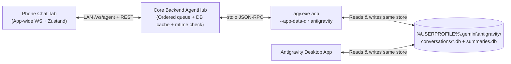

# Plan: OBS Studio Control + Antigravity Chat & PC Sync (Core)

> Status: **DRAFT PLAN FOR REVIEW** — waiting for your feedback / "proceed".
> All environment details below were verified on this PC on 2026-11-16 (OBS 32.2.2, `agy` 1.5.9).

---

## 1. Goals

1. **OBS Studio Control on Mobile Home Tab:**
   - Open/launch OBS Studio on the PC from the phone.
   - Start Recording, Pause / Resume Recording, and Stop Recording from the phone.
   - Show live OBS state (`OFFLINE`, `STANDBY`, `RECORDING`, `PAUSED`), elapsed recording timer, and last saved file path in real time (even if toggled from the PC).
2. **Antigravity Chat Working Properly & Synced with Antigravity on PC:**
   - Fix Antigravity chat so opening existing PC sessions, sending prompts, seeing thinking/tool cards, approving permissions, and creating new chats all work reliably.
   - Store and load conversations from the **same Antigravity store** used by the desktop app so chats created or continued from mobile appear in Antigravity on the PC, and PC updates sync back to mobile.
   - Verify and handle real-time behavior when a session is open on the PC at the same time (see §4.2 for the exact technical boundary and Phase 0 test).

---

## 2. Verified Facts on This PC

### OBS Studio
- **Binary:** `C:\Program Files\obs-studio\bin\64bit\obs64.exe` (OBS 32.2.2, 64-bit Windows, NVENC configured, saves to `F:/Recording`).
- **Built-in WebSocket (`obs-websocket` v5):** config exists at `%APPDATA%\obs-studio\plugin_config\obs-websocket\config.json` with:
  - `server_port`: `4455`
  - `auth_required`: `true` (password already configured)
  - `server_enabled`: **`false`** (currently disabled)
- **Backend dependency:** `websockets 17.4` is already installed in `backend\.venv`, so an async `obs-websocket` v5 client needs **zero new Python dependencies**.

### Antigravity (`agy` & existing Core chat bridge)
The previous commit (`fcff0757`) added an ACP bridge (`backend/services/agent/*` and `mobile/src/app/(tabs)/chat/*`), **but it fails to sync with Antigravity Desktop and fails on PC sessions due to 5 verified bugs:**
1. **Wrong data directory (`acp_client.py`):** `agy.exe acp --process-per-session` runs without `--app-data-dir`, so it defaulted to `%USERPROFILE%\.gemini\antigravity-cli` instead of `%USERPROFILE%\.gemini\antigravity` (where the desktop app stores all conversations).
   - *Evidence in `backend/logs/agy_acp.log.6644` & `backend/data/agent.db`:* Mobile-created chat `4a414017-...` was saved only inside `antigravity-cli\conversations\`, while prompting desktop chat `ffdbcb55-...` failed with `LoadTrajectory LoadUnsafe failed: trajectory ... not found in any store` and saved an empty reply.
   - *Verified fix test:* Running `agy.exe acp --app-data-dir antigravity` pointed directly to `%USERPROFILE%\.gemini\antigravity`, returned all 186 desktop sessions (including this active session `5cba6d19-b86f-43a2-8553-a799167d1492`), and `session/load` on `ffdbcb55-...` replayed 5 user turns, 51 thought chunks, 110 tool calls, and 5 assistant turns.
2. **History never loaded on open (`hub.py`):** `ensure_session_loaded()` is only called when sending a prompt—never when opening a session or calling `GET /api/agent/sessions/{id}/history`. Opening any PC chat shows blank history.
3. **Replay & thinking events dropped (`hub.py` + `agentStore.ts`):**
   - During `session/load`, ACP replays `user_message_chunk`, `agent_thought_chunk`, `tool_call`, and `agent_message_chunk`. `hub.py` ignores `user_message_chunk`, listens for `"thought_chunk"` instead of `"agent_thought_chunk"`, and discards all replay updates because `_active_turns` is empty during load.
   - `acp_client.py` dispatches notifications with `asyncio.create_task`, allowing chunks to execute out of order during replay/streaming.
   - `agentStore.ts` drops thoughts that arrive before the first text chunk (no `else` branch), mutates objects in place, and ignores `user_message` / `config` events.
4. **No PC → Phone refresh after initial load (`hub.py` + `agentSocket.ts`):** Once a session enters `_loaded_sessions`, `hub.py` never checks if the PC modified the `.db` file afterward. Also `agentSocket.ts` always re-subscribes with `since_seq: 0` (causing duplicate/missing events) and is only initialized when opening the Chat tab instead of app-wide in `_layout.tsx`.
5. **Hardcoded permission IDs & static models (`PermissionCard.tsx` + `[sessionId].tsx`):** `PermissionCard` sends hardcoded `"allow"`/`"deny"` instead of rendering ACP's actual `options[].optionId`, and model selection is hardcoded instead of reading ACP's live `configOptions`.

---

## 3. Part 1 — OBS Studio Control (Mobile Home Tab)

### 3.1 Placement Choice: Dedicated Card on Mobile `HOME` Tab
Placing an **`OBS STUDIO // RECORDER`** card directly on `HOME` (`mobile/src/app/(tabs)/index.tsx`, between `ForegroundCard` and `ActionGrid`) keeps all PC hardware/app controls in one glanceable deck without adding a 5th tab for just 4 buttons.

```
+---------------------------------------------------+
| OBS STUDIO // RECORDER         [● RECORDING 00:42]|
+---------------------------------------------------+
| Status: Recording active (1920x1080 / MKV)        |
| Output: F:\Recording\2026-11-16 23-59-01.mkv      |
|                                                   |
| [ OPEN OBS ]   [ ● REC ]   [ ❚❚ PAUSE ]  [ ■ STOP ]|
+---------------------------------------------------+
```

### 3.2 Backend Architecture
- **New service `backend/services/obs_controller.py`:**
  - **Binary discovery:** `CoreConfig.obs_path` → `C:\Program Files\obs-studio\bin\64bit\obs64.exe` → `C:\Program Files (x86)\...` → `shutil.which`.
  - **Safe Windows launch:** `subprocess.Popen([obs_exe, ...], cwd=str(Path(obs_exe).parent))` (critical: OBS fails to find `locale/en-US.ini` if `cwd` is not `obs64.exe`'s folder). Supports optional `--minimize-to-tray`.
  - **WebSocket v5 client (using `websockets 17.4`):**
    - Reads host/port/password from Core config, falling back automatically to `%APPDATA%\obs-studio\plugin_config\obs-websocket\config.json` (never logs passwords).
    - Performs `Hello` (`op: 0`) → SHA-256 `(password + salt) + challenge` → `Identify` (`op: 1`) → `Identified` (`op: 2`).
    - Subscribes to `Outputs` events (`RecordStateChanged`) and queries `GetRecordStatus` (`outputActive`, `outputPaused`, `outputDuration`, `outputBytes`).
    - Exposes clean methods: `open_obs(start_recording=False)`, `start_recording()`, `pause_recording()`, `resume_recording()`, `toggle_pause()`, `stop_recording()`, `get_status()`, `enable_obs_websocket_if_safe()`.
  - **Smart edge cases:**
    - Tapping **REC** when OBS is closed can either launch OBS + wait up to ~10s for WebSocket ready + start recording automatically (recommended), or prompt to open first.
    - If OBS is running with `obs-websocket` disabled (`server_enabled: false`), status returns `state: "ws_disabled"` with a clear actionable message on mobile + a one-click **"Enable OBS WebSocket"** button in the local Web Control Panel (or auto-enable before Core launches OBS when `obs64.exe` is not running, with a `.bak` backup of OBS's `config.json`).
    - Broadcasts `obs_status` updates over the existing `/ws/monitor` WebSocket whenever state changes (plus a 1s elapsed-time ticker while recording), so mobile stays in sync even if you press hotkeys on the PC.
- **New routes `backend/api/routes_obs.py`** (protected by `require_mobile_auth`):
  - `GET /api/obs/status`
  - `POST /api/obs/open`
  - `POST /api/obs/record/start`
  - `POST /api/obs/record/pause`
  - `POST /api/obs/record/resume`
  - `POST /api/obs/record/stop`
- **Config additions (`CoreConfig` in `backend/core/config_manager.py`):**
  - `obs_path: Optional[str] = None`
  - `obs_ws_host: str = "127.0.0.1"`
  - `obs_ws_port: Optional[int] = None` (auto-reads OBS's `config.json` when `None`)
  - `obs_ws_password: Optional[str] = None` (auto-reads OBS's `config.json` when `None`)
  - `obs_auto_enable_ws: bool = True` (only modifies OBS `config.json` while `obs64.exe` is stopped, after writing `.bak`)

### 3.3 Mobile UI (`mobile/`)
- **`mobile/src/components/ObsControlCard.tsx`:**
  - Displays connection/recording badge (`OFFLINE` / `STANDBY` / `RECORDING` / `PAUSED` / `WS DISABLED`), live recording duration counter, and last saved recording path.
  - 4 primary tactile actions matching the request:
    1. **OPEN OBS** (launches OBS; or brings/checks OBS status if already open)
    2. **REC / RESUME** (starts recording when standby/offline, or resumes when paused)
    3. **PAUSE** (pauses active recording)
    4. **STOP** (stops recording and shows saved file name/path)
  - Listens to `obs_status` events from `services/ws.ts` + refreshes via `GET /api/obs/status` on Home pull/mount.

---

## 4. Part 2 — Antigravity Chat Fix & PC ↔ Phone Sync

### 4.1 Architecture Fix: Shared Antigravity Store + Proper Replay


### 4.2 Important Architectural Reality & Phase 0 Gate Test ("Appear on PC at the same time")
Before writing production code, we need to be 100% transparent about how `agy acp` interacts with the **already-open** Antigravity Desktop window:
- **What `--app-data-dir antigravity` guarantees:** Every new chat (`session/new`) and every prompt (`session/prompt`) sent from the phone is written into `%USERPROFILE%\.gemini\antigravity\conversations\<id>.db` and `conversation_summaries.db` — the exact store Antigravity Desktop uses. No more isolated `antigravity-cli` folder.
- **What has a documented boundary (`agy help acp`):** `agy acp` spawns its own Language Server child process; there is no documented `agy` flag to inject messages directly into the already-running Desktop IDE window's in-memory UI state.
- **Phase 0 Gate Test (1 quick turn on a throwaway session before Phase 2):**
  1. Open a throwaway conversation in Antigravity Desktop, then send 1 prompt to that same session via `agy acp --app-data-dir antigravity`.
  2. Observe whether the open Desktop chat tab refreshes live on screen or requires switching away/back (or reopening) to display the new turn, and confirm SQLite WAL handles both without corruption.
  3. Create a `session/new` via `agy acp --app-data-dir antigravity` and verify it appears under the correct project in the Antigravity Desktop sidebar.
- **Note on `agy remote-control`:** If the Phase 0 test confirms that Antigravity Desktop only refreshes disk changes on thread switch/reopen (and does not live-stream into an already-open tab), the only official Antigravity mechanism that mirrors a single active desktop window in real time is Google's `agy remote-control start` (which runs in a mobile browser over Google cloud, outside Core). We can optionally add an `agy remote-control` status/toggle helper if you want it alongside Core's LAN chat, while Core's Chat tab gives you full native LAN control over all projects/sessions in the shared store.

### 4.3 Backend Fixes (`backend/services/agent/*`, `backend/api/*`)
1. **`agy_locator.py` & `acp_client.py`:**
   - Pass `--app-data-dir`, `cfg.agy_app_data_dir` (default `"antigravity"`) to `agy.exe acp`.
   - Replace per-notification `asyncio.create_task(...)` with a single ordered `asyncio.Queue` dispatcher so `session/update` notifications are strictly sequential.
   - Reject pending futures immediately on process exit; expose clear auth/version status in `/api/agent/status`.
2. **`store.py`:**
   - Add an explicit integer `turn_order` / `seq` column (or monotonic timestamp + upsert) to `messages` so replayed conversations preserve exact turn order instead of colliding on `_iso_now()`.
   - Track `last_synced_mtime` / `last_synced_updated_at` per session so we know when the PC updated a conversation on disk.
   - Add `replace_session_history(...)` for clean atomic re-sync from ACP `session/load` replay while preserving local `events` sequence continuity.
3. **`hub.py`:**
   - Handle **all** ACP `sessionUpdate` types during both replay and live turns:
     - `user_message_chunk`
     - `agent_thought_chunk` (and legacy alias `thought_chunk`)
     - `tool_call` (plus `tool_call_update` when present)
     - `agent_message_chunk`
     - `session_info_update`, `available_commands_update`, `config_option_update`, `current_mode_update`
   - Implement `sync_session_if_stale(session_id, cwd)`:
     - Checks `%USERPROFILE%\.gemini\antigravity\conversations\<session_id>.db` (+ `.db-wal`) mtime and/or `session/list` `updatedAt`.
     - If never synced or modified on disk by the PC since Core's last turn, runs `session/close` (if loaded) + `session/load`, buffers the full replay, persists consolidated turns + tools into `agent.db`, captures live `configOptions` (`model`, `thought_level`, `mode`), and broadcasts `history_synced` to subscribed sockets.
   - Call `sync_session_if_stale` automatically on:
     - `GET /api/agent/sessions/{id}/history`
     - WS `subscribe`
     - `submit_prompt` (before prompting, so Core's ACP worker never prompts stale state if you just typed on the PC).
   - Also validate `create_session` `cwd` against existing project roots / valid non-system directories (fixing L24) and pass `configOptions` back to mobile.
   - Add `POST /api/agent/sessions/{id}/sync` so mobile can force-pull fresh PC state anytime with one tap.
4. **`projects.py`:**
   - Filter out all `%USERPROFILE%\.gemini\*` internal folders cleanly.
   - Improve `openOnPc` detection and also read `antigravity\conversations\<sid>.db-wal` recency to flag recently active PC sessions.

### 4.4 Mobile Fixes (`mobile/src/`)
1. **App-wide socket lifecycle (`src/app/(tabs)/_layout.tsx` + `src/services/agentSocket.ts`):**
   - Initialize `agentSocket.init(pcIp, pcPort, authToken)` in `TabLayout` instead of only inside `chat/index.tsx`, so approvals/notifications and active streams stay alive across all tabs.
   - Track `lastSeqBySession` in `agentStore` and pass real `since_seq` on reconnect instead of `0`.
   - Queue/notify cleanly if user hits Send while socket is reconnecting instead of dropping silently.
2. **State & streaming fixes (`src/store/agentStore.ts`):**
   - Stop mutating messages/tools in place (return immutable copies).
   - Support `agent_thought_chunk` arriving *before* `agent_message_chunk` (create the streaming assistant bubble immediately on first thought/tool/text chunk).
   - Handle `user_message` (deduped by `id` with optimistic message), `config` (`configOptions` updates), and `history_synced` (refresh thread cleanly when PC updates the session).
   - Store `configOptionsBySession` so the UI displays real available models/thinking levels/modes from ACP.
3. **Chat UI improvements (`src/app/(tabs)/chat/*` & `src/components/agent/*`):**
   - `PermissionCard.tsx`: render the actual `permission.options` (`optionId`, `name`) returned by ACP instead of hardcoded `"allow"`/`"deny"`.
   - `[sessionId].tsx`:
     - Populate model, thinking level, and mode chips dynamically from ACP's `configOptions` (fallback to defaults if offline).
     - Add a **Sync** button (`RotateCcw` icon is already imported!) to pull latest PC messages immediately, plus display a subtle banner if the session was recently updated on PC.
     - Fix auto-scroll so it doesn't yank the user back to the bottom when scrolling up to read older messages.
     - Add local notifications (via `expo-notifications`) when `permission_request` or `turn_ended` arrives while on another tab / app foregrounded.
   - `chat/index.tsx` & `[projectId].tsx`:
     - Keep `New` session modal aligned with ACP's real model IDs (`claude-sonnet-5-5`, `gemini-4-hydrogen`, `gemini-3.8-flash`, etc.) and refresh project/session state on focus.

---

## 5. Planned File Changes

### Backend
- `backend/core/config_manager.py` — add `obs_*` and `agy_app_data_dir` config fields.
- `backend/services/obs_controller.py` *(new)* — OBS discovery, safe launch, `obs-websocket` v5 client, state tracking, optional safe `server_enabled` helper.
- `backend/api/routes_obs.py` *(new)* — `/api/obs/*` endpoints.
- `backend/api/websockets.py` — push `obs_status` updates over `/ws/monitor`.
- `backend/main.py` — register `obs_router` and clean shutdown of OBS WS client.
- `backend/services/agent/acp_client.py` — `--app-data-dir antigravity`, ordered async update queue, exit future rejection.
- `backend/services/agent/store.py` — ordered message persistence, `last_synced_mtime`, atomic history sync.
- `backend/services/agent/hub.py` — replay buffering (`user_message_chunk`, `agent_thought_chunk`, `tool_call`, `agent_message_chunk`), PC staleness sync, `configOptions` forwarding, `cwd` validation.
- `backend/services/agent/projects.py` — filter `.gemini` internal dirs, expose active `.db-wal` PC activity hint.
- `backend/api/routes_agent.py` — trigger `sync_session_if_stale` on `/history`, add `POST /sessions/{id}/sync`, return `configOptions`.
- `backend/web_panel/index.html` & `app.js` *(light addition)* — show OBS status + quick "Enable OBS WebSocket" button if needed.
- `backend/tests/test_obs_controller.py` *(new)* & updates to `backend/tests/test_agent_core.py` / `test_agent_api.py` / `test_agent_ws_e2e.py`.

### Mobile
- `mobile/src/components/ObsControlCard.tsx` *(new)* — OBS Open / Rec / Pause-Resume / Stop UI card.
- `mobile/src/app/(tabs)/index.tsx` — mount `ObsControlCard` on Home tab.
- `mobile/src/services/api.ts` — add OBS API methods (`getObsStatus`, `openObs`, `startObsRecording`, `pauseObsRecording`, `resumeObsRecording`, `stopObsRecording`).
- `mobile/src/services/ws.ts` — handle `obs_status` WebSocket events.
- `mobile/src/app/(tabs)/_layout.tsx` — initialize `agentSocket` app-wide + handle agent local notifications.
- `mobile/src/services/agentSocket.ts` — real `since_seq` reconnect, offline send warning/handling.
- `mobile/src/services/agentApi.ts` — pass `cwd`/sync on history fetch, add `syncSessionHistory`.
- `mobile/src/store/agentStore.ts` — immutable updates, early `agent_thought_chunk`, `user_message` dedupe, `configOptionsBySession`, `history_synced`.
- `mobile/src/components/agent/PermissionCard.tsx` — render dynamic ACP `options`.
- `mobile/src/app/(tabs)/chat/session/[sessionId].tsx` & `[projectId].tsx` — dynamic models/modes/thinking, manual sync button, smart scroll.

---

## 6. Verification Plan

1. **Phase 0 Gate (before finalizing chat sync behavior):**
   - Run a 1-turn check on a throwaway conversation with `--app-data-dir antigravity` while Antigravity Desktop is open, and record whether the Desktop UI updates live vs on conversation switch/reload.
2. **Backend Automated Tests (`backend/.venv\Scripts\python.exe -m pytest`):**
   - Unit tests for `obs_controller` against a mock `obs-websocket` v5 server (auth challenge/salt handshake, `StartRecord`, `PauseRecord`, `ResumeRecord`, `StopRecord`, `RecordStateChanged` events, `ws_disabled` handling).
   - Unit & E2E tests for ACP replay parsing (`user_message_chunk`, `agent_thought_chunk`, `tool_call`, `agent_message_chunk`), ordered queue, `since_seq` reconnect without duplicates, and stale-history re-sync.
3. **Mobile Static Check:**
   - `cd mobile && npm run typecheck` must pass with 0 errors.
4. **Live PC + Phone Verification:**
   - Verify OBS launch + Start / Pause / Resume / Stop recording from mobile Home tab produces an `.mkv` file in `F:\Recording` and live timer updates.
   - Verify opening an existing PC Antigravity thread shows full history on mobile, sending a prompt works and appears in Antigravity Desktop, and creating a new chat from mobile appears in Antigravity Desktop under the right project.

---

## 7. Decisions Needed Before I Proceed

1. **OBS Placement:** Are you happy with the **OBS Recorder card on the `HOME` tab**, or would you still prefer a dedicated 5th **`OBS`** tab? *(Default: `HOME` tab)*
2. **OBS WebSocket Auto-Enable:** Currently `obs-websocket` is `server_enabled: false` in your OBS config. Should Core **automatically set `server_enabled: true`** in `%APPDATA%\obs-studio\plugin_config\obs-websocket\config.json` (only while OBS is closed, with a `.bak` backup), or would you rather toggle it manually inside OBS (`Tools → WebSocket Server Settings`)? *(Default: auto-enable safely when OBS is closed)*
3. **Click `REC` while OBS is closed:** Should tapping **REC** automatically open OBS and start recording once ready, or require tapping **OPEN OBS** first? *(Default: auto-open & start recording)*
4. **Antigravity Desktop Live Sync Boundary:** During Phase 0, we will test whether `agy acp --app-data-dir antigravity` refreshes an *already-open* Desktop chat tab immediately or only when reopening/switching threads. If Antigravity Desktop doesn't live-refresh an already-open tab from disk, do you also want a toggle/status card in Core for `agy remote-control` (official cloud mirror), or is fixing the shared-store ACP chat + auto-sync enough? *(Default: fix shared-store ACP + Phase 0 test first, report exact behavior)*
